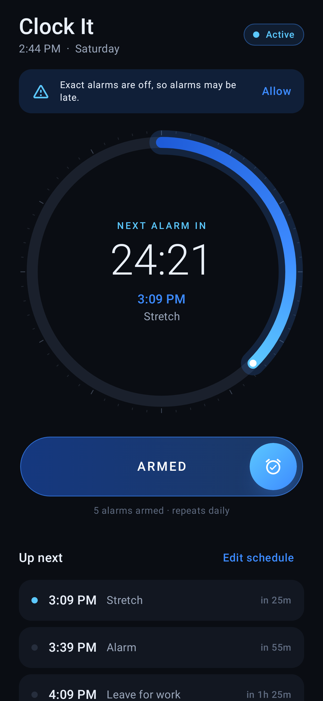
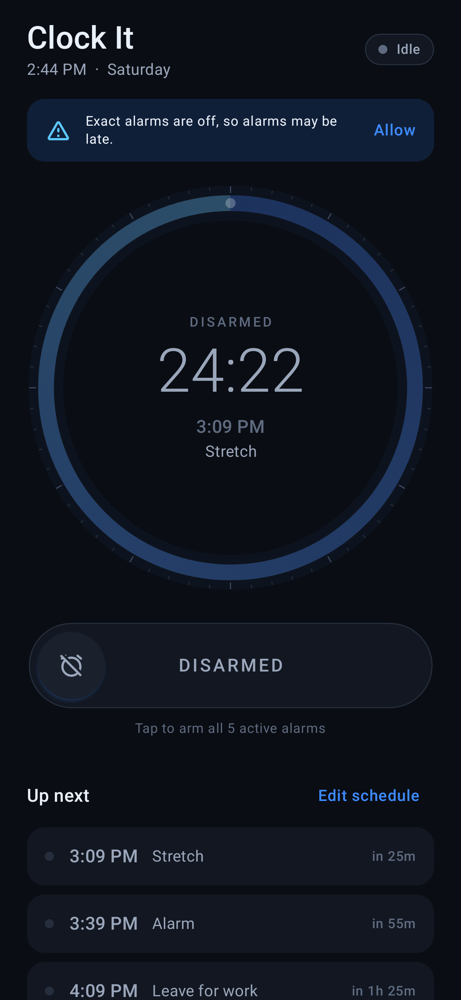
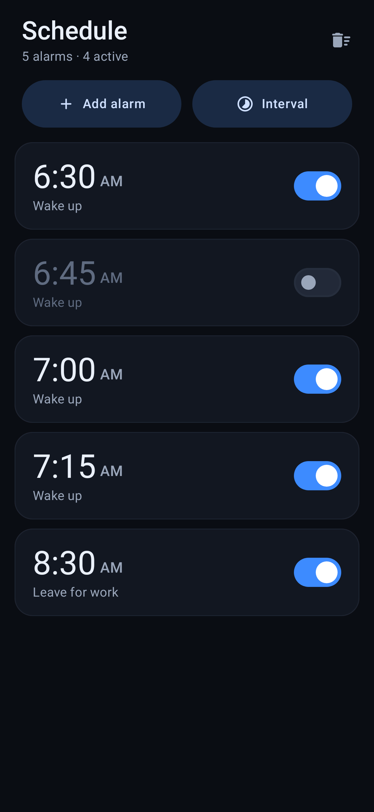
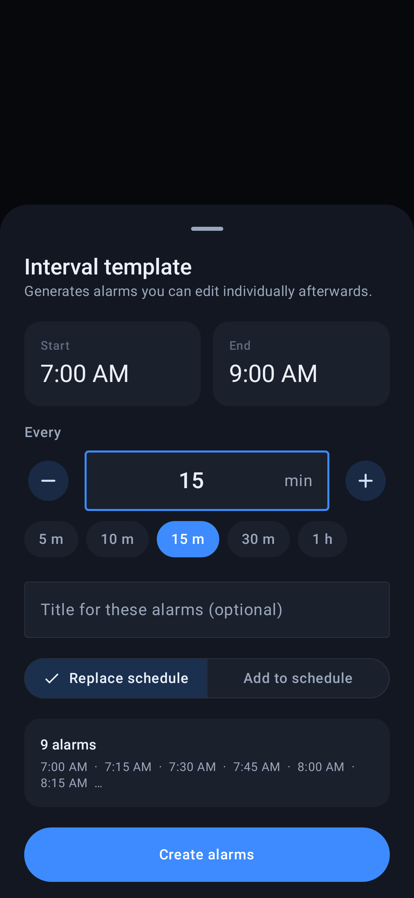

# Clock It

A native Android alarm-schedule app (Kotlin + Jetpack Compose, Material 3) with a dark theme and blue accents.

| Countdown (armed) | Countdown (disarmed) | Schedule | Interval template |
|---|---|---|---|
|  |  |  |  |

## Features
- **Schedule** – a list of daily alarms, each with an optional title and its own on/off switch. Tap an alarm to change its time or title; swipe left to delete.
- **Arm / disarm everything** – one large toggle on the main screen turns the whole schedule on or off.
- **Countdown ring** – the main screen shows a circular timer counting down to the next alarm. The ring empties as the gap since the previous alarm runs out. An "Up next" list sits below it.
- **Interval template** – pick a start time, an end time and an interval in minutes, and it generates the alarms. They are ordinary alarms afterwards, so you can edit or delete any of them. You can replace the schedule or add to it. If the end time is earlier than the start time, the range runs past midnight.
- **Ringing** – a full-screen alarm shows over the lock screen and plays the system alarm sound with vibration, with **Dismiss** and **Snooze (5 min)**. It stops by itself after 10 minutes.
- Survives reboots, time-zone/clock changes and app updates.

## How alarms are scheduled
Only the *next* fire time is registered with `AlarmManager.setAlarmClock` (exact, Doze-proof, shown in the status bar). When it fires, the receiver rings and queues the following one. So even a dense interval schedule never reaches Android's per-app alarm limit. Alarms set for the same minute ring together.

## Build
Requirements: JDK 17+ and the Android SDK (platform 35). Open in Android Studio, or:

```
./gradlew assembleDebug        # app/build/outputs/apk/debug/app-debug.apk
./gradlew testDebugUnitTest    # logic tests
./gradlew recordRoborazziDebug # regenerate screenshots
```

Minimum Android version is 8.0 (API 26). On Android 12/12L the app asks for the "Alarms & reminders" permission. On Android 13+ it asks for notification permission.
